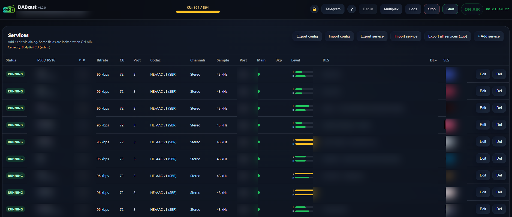

# DABcast - WebUI for DAB/DAB+ (ODR-mmbTools)

Modern web interface for managing DAB/DAB+ multiplexes with ODR-mmbTools.

Version: **1.3.1**

> *Free to use. Free to modify. Not for resale.*



---

## 📋 Table of contents

- [Dependencies](#-dependencies)
- [Installation](#-installation)
- [Quick start](#-quick-start)
- [Automatic startup (systemd)](#️-automatic-startup-systemd)
- [Features](#-features)
- [Configuration](#️-configuration)
- [Project structure](#-project-structure)
- [Third-Party Software](#third-party-software)
- [License](#license)

---

## 📦 Dependencies

### Required

| Dependency | Description |
|------------|-------------|
| **Node.js** | JavaScript runtime (v18+) |
| **odr-dabmux** | DAB multiplexer |
| **odr-audioenc** | DAB+ audio encoder |
| **odr-padenc** | PAD encoder (metadata) |
| **odr-dabmod** | OFDM modulator (for TX transmission) |
| **ImageMagick** | SLS image conversion and resizing (320×240 JPEG) |
| **dablin_gtk** | DAB+ player/decoder for real-time multiplex monitoring |
| **socat** | Network stream relay for monitoring support |
| **wmctrl** | X11 window manager for monitoring support |
| **xdotool** | Alternative to wmctrl for monitoring support (fallback) |

### Optional

| Dependency | Description | Usage |
|------------|-------------|-------|
| **libhackrf** | HackRF One support | HackRF TX transmission mode |

---

## 🚀 Installation

### Automatic installation (Debian/Ubuntu)

An automatic installation script is provided for Debian and Ubuntu:

```bash
# Clone the repository
git clone https://github.com/DABodr/DABcast-diffusion-software.git
cd DABcast-diffusion-software

# Run the installation script
sudo ./install-tools.sh
```

The script automatically installs:
- ✅ Node.js v18+ (NodeSource)
- ✅ ODR-mmbTools (odr-dabmux, odr-audioenc, odr-padenc, odr-dabmod)
  - **Ubuntu**: via OpenDigitalRadio PPA
  - **Debian**: via backports (bookworm-backports, buster-backports)
- ✅ ImageMagick (SLS conversion)
- ✅ Dablin (DAB+ player for monitoring)
- ✅ Monitoring tools (socat, wmctrl, xdotool)
- ✅ Runtime dependencies (libzmq, libboost, libfdk-aac, libvlc, etc.)
- ✅ Node.js dependencies (npm install)
- ❓ HackRF support (optional, prompted during installation)

### Manual installation

If you prefer to install manually:

#### 1. Install Node.js v18+

```bash
curl -fsSL https://deb.nodesource.com/setup_18.x | sudo bash -
sudo apt-get install -y nodejs
```

#### 2. Install ODR-mmbTools

**Ubuntu:**
```bash
sudo add-apt-repository ppa:opendigitalradio/mmbtools
sudo apt-get update
sudo apt-get install odr-dabmux odr-audioenc odr-padenc odr-dabmod
```

**Debian (bookworm/buster):**
```bash
# Add backports with non-free
echo "deb http://deb.debian.org/debian bookworm-backports main contrib non-free non-free-firmware" | sudo tee /etc/apt/sources.list.d/bookworm-backports.list
sudo apt-get update
sudo apt-get install -y -t bookworm-backports odr-dabmux odr-audioenc odr-padenc odr-dabmod
```

#### 3. Install dependencies

```bash
sudo apt-get install -y \
  imagemagick \
  libzmq3-dev \
  libboost-system-dev \
  libcurl4-openssl-dev \
  libasound2-dev \
  libfdk-aac-dev \
  libvlc-dev \
  libusb-1.0-0-dev
```

#### 4. Install Node.js dependencies

```bash
cd DABcast/server
npm install
```

---

## ⚡ Quick start

```bash
cd server
npm start
```

Then open in a browser: **http://localhost:9090**

### Demo preset

A **DemoMux** preset with 6 services is included to quickly test the interface.

MOT directories (DLS/SLS) are in `data/mot/*`.

---

## 🖥️ Automatic startup (systemd)

### Installation via .deb package (recommended)

```bash
sudo dpkg -i dabcast_X.Y.Z_amd64.deb
sudo systemctl status dabcast
```

The service starts automatically at boot. Logs are accessible via:

```bash
journalctl -u dabcast -f
```

#### Configuration `/etc/default/dabcast`

The package installs `/etc/default/dabcast` with commented default values.
**This file is preserved during upgrades** (dpkg conffile): your changes are never overwritten.

```bash
sudo nano /etc/default/dabcast
sudo systemctl restart dabcast
```

| Variable | Description | Default |
|----------|-------------|---------|
| `DABCAST_DATA_DIR` | Data directory (presets, logs, runtime, mot) | `/var/lib/dabcast` |
| `PORT` | WebUI port | `9590` |
| `HOST` | Listen address | `0.0.0.0` |
| `DABCAST_TELEGRAM_BOT_TOKEN` | Telegram bot token (keep secret) | *(not set)* |
| `DABCAST_TELEGRAM_CHAT_ID` | Destination user/group/channel ID | *(not set)* |
| `DABCAST_TELEGRAM_MIN_LEVEL` | Forwarded log level: `DEBUG`, `INFO`, `WARN`, or `ERROR` | `ERROR` |
| `DABCAST_TELEGRAM_SILENT` | Send Telegram messages silently | `false` |
| `DISPLAY` | X11 display — required for the Dablin button | *(not set)* |
| `XAUTHORITY` | X11 authority file | *(not set)* |
| `XDG_RUNTIME_DIR` | PulseAudio/D-Bus runtime dir — required for Dablin audio | *(not set)* |

To enable Telegram alerts from the WebUI, open **Telegram** in the top bar, enter
the BotFather token and destination chat ID, enable notifications, and select
**Send test**. The token is stored separately in `data/.telegram.json` with mode
`0600`; it is never returned by the API or included in configuration exports.
Only `ERROR` messages are forwarded by default. Environment variables in
`/etc/default/dabcast` remain available as a deployment-time fallback.

#### Dablin button under systemd

The "Launch Dablin" button requires the service to have access to your X11 session and PulseAudio audio.
Without configuration, `dablin_gtk` launches but closes immediately (no DISPLAY, no PulseAudio).

```bash
# Get your values
echo $DISPLAY        # e.g.: :0
echo $XAUTHORITY     # e.g.: /home/odr/.Xauthority
id -u                # e.g.: 1000
```

Uncomment and adapt in `/etc/default/dabcast`:

```bash
DISPLAY=:0
XAUTHORITY=/home/odr/.Xauthority
XDG_RUNTIME_DIR=/run/user/1000   # replace 1000 with your UID
```

Then restart the service: `sudo systemctl restart dabcast`

### Installation from sources

A systemd file is provided for installations from the git repository:

```bash
# Adapt WorkingDirectory and ExecStart to your installation path
sudo cp dabcast.service /etc/systemd/system/
sudo systemctl daemon-reload
sudo systemctl enable --now dabcast
```

The `dabcast.service` file at the root contains commented `Environment=` lines for
`DISPLAY`, `XAUTHORITY` and `XDG_RUNTIME_DIR` (required for the Dablin button).

---

## ✨ Features

### DAB+ service management

- ✅ **Create/edit/delete** services
- ✅ **Drag & drop** to reorder services in the multiplex
- ✅ **ETSI EN 300 401 validation** (PI, PS8, PS16, bitrates, CU)
- ✅ **Automatic Capacity Unit calculation** (CU) with ETSI EEP-A and EEP-B formulas
- ✅ **ON AIR locking**: certain critical fields (bitrate, PI, PS) are protected during broadcast
- ✅ **Multi-source support**: HTTP(S), local file, ALSA sound card, GStreamer pipeline
- ✅ **Backup sources**: automatic failover on failure (watchdog)
- ✅ **Mono and stereo support**: adaptive VU meter (single "M" bar in mono, "L/R" dual in stereo)
- ✅ **Web Player**: listen to any service of the running multiplex from the browser (PC or phone) — audio decoded from the mux output (dablin → ffmpeg MP3, a few seconds behind live), real-time L/R meter with peak hold, DLS / DL+ / slide of the service. Needs `dablin` and `ffmpeg` on the server (installed by `install-tools.sh`)
- ✅ **Audio levels assistant**: click the "Mux inputs" card to compare the peaks of every service over a sliding 5-minute window and get a suggested gain (target -3 to -12 dBFS); Apply saves the gain, a mux restart applies it

### Metadata (DLS/SLS)

- ✅ **DL+ (Dynamic Label Plus)**: structured metadata display (artist, title)
  - DL+ badge shown only when tags are actually transmitted
  - Support for "Artist - Title" format with automatic parsing
- ✅ **4 metadata modes**:
  - **Stream**: automatic extraction from Icecast/Shoutcast headers
  - **JSON**: retrieval from an external API with:
    - Dot-path (`now.artist`), arrays (`data.0.name`), fallbacks (`artist|name`)
    - Automatic cover art download (cover.jpg)
    - JSON test and cover preview in the UI
    - Detailed metadata logs
  - **FILE**: reading from local or HTTP text files
  - **Manual DLS**: manual DLS text entry with "Show default DLS" option
- ✅ **Slideshow (SLS)**:
  - Automatic image download from URLs
  - Automatic conversion to DAB format (JPEG 320×240)
  - Drag & drop support for manual upload
  - **Automatic rotation**: slideshow every 5 seconds between all images (logo.jpg, cover.jpg)
  - **Clickable preview**: click on thumbnail to display full size (320x240) with continuous rotation

### Monitoring and logs

- ✅ **Real-time audio levels**: visual level indicators per service
  - Mono VU meter (M bar) or stereo (L/R bars)
  - Correct parsing of odr-audioenc mono format
- ✅ **Status dots**: visual indicator of active stream (green/red)
- ✅ **Watchdog**: process health monitoring and audio stream surveillance
- ✅ **Mux input buffer monitoring** (read-only): DABcast queries the odr-dabmux management port (ZMQ, `managementport`) every 5 s while ON AIR
  - Per-service tag in the Status column: `BUF OK`, `UNSTABLE`, `SILENCE`, `NO DATA` (hover for fill, underruns, overruns, peaks); `STARTING` (blue, no alarm) during the first minute after Start
  - `UNSTABLE` in yellow = underruns increased in the last 30 s (listeners may hear dropouts, `▲` = since the previous reading); an input dabmux still reports `Unstable` for past glitches only (e.g. start-up prebuffering) is shown as `BUF OK`
  - "Mux inputs" card in the summary row; `SILENCE` / `NO DATA` inputs count as alarms; full table in the About (?) dialog
  - Detects dropouts the process watchdog cannot see (encoder alive but not delivering audio); no automatic action is taken
- ✅ **Detailed logs**:
  - `data/logs/dabweb.log` (append-only, with timestamps)
  - `/api/logs/metadata` endpoint with filtering
  - JSON metadata logs (fetch, parse, download, resize)
- ✅ **ODR command display**: inspection of odr-audioenc/padenc arguments
- ✅ **About dialog**: real-time system information (CPU, RAM, uptime, ODR versions) and mux input buffer stats

### Import/Export

- ✅ **Full backup**: export of multiplex configuration as JSON
- ✅ **Preset loading**: full configuration import
- ✅ **Individual import/export**: copy/paste a service between presets

### Monitoring

- ✅ **Integrated player (Dablin)**: real-time listening to the DAB+ multiplex

### Transmission modes

- ✅ **EASYDAB**: ZMQ output for EasyDAB (testing/development)
  - ZMQ output on port 18081
  - Raw ETI TCP output on port 9901
- ✅ **EDI**: Ensemble Distribution Interface over TCP
  - Configurable EDI port (default: 13000)
- ✅ **USRP1**: raw output to USRP/SDR (stdout)
- ✅ **HackRF TX**: direct transmission via HackRF One
  - Automatic hackrf_transfer detection
  - TX gain and DAB Band III frequency configuration
  - FIR filtering included
  - Error message if HackRF not connected

### Robustness and security

- ✅ **Safe startup**: detection of missing binaries (ODR-mmbTools, libhackrf)
  - Pre-check before mux startup
  - Toast error messages (5s) with precise details
  - No crash if odr-audioenc/padenc/hackrf_transfer not found
- ✅ **Error handling**:
  - `child.on('error')` handler to prevent ENOENT crashes
  - Automatic cleanup of temporary files (cover.jpg) on mode changes
  - Runtime reset (currentSlsUrl, dlplusActive) on config changes

---

## ⚙️ Configuration

### `data/settings.json` file

The `data/settings.json` file is automatically generated on first launch with default values.

```json
{
  "host": "0.0.0.0",
  "port": 9090,
  "odrBinDir": "",
  "dataDir": "./data",
  "dabmux": {
    "telnetPort": 12721,
    "managementPort": 12720,
    "zmqEndpoint": "tcp://lo:12722",
    "txMode": "EASYDAB",
    "easyDabOutput": {
      "ip": "0.0.0.0",
      "port": 18081,
      "netPort": 9901
    },
    "ediTcpListenPort": 13000,
    "ediPftEnabled": false,
    "ediFec": 2,
    "ediTistOffsetSec": 0,
    "hackrf": {
      "dabBlock": "7A",
      "maxFramesQueued": 580,
      "gainmode": 2,
      "digitalGain": 1,
      "rate": 4096000,
      "txGain": 47
    }
  },
  "auth": {
    "username": "admin",
    "password": "dabcast",
    "mustChangePassword": true
  },
  "ensemble": {
    "idHex": "0xFEFE",
    "eccHex": "0xE1",
    "label": "DABcast WebUI",
    "shortlabel": "DABcast",
    "internationalTable": 1,
    "localTimeOffset": "auto"
  }
}
```

### Key parameters

| Parameter | Description | Default |
|-----------|-------------|---------|
| `port` | WebUI port | 9090 |
| `odrBinDir` | ODR binaries path (if not in PATH) | `""` |
| `txMode` | Transmission mode (`EASYDAB`, `EDI`, `USRP1`, `HACKRF`) | `EASYDAB` |
| `easyDabOutput.port` | ZMQ port for EasyDAB | 18081 |
| `easyDabOutput.netPort` | TCP port for the raw ETI monitoring stream (Dablin/socat, including EDI mode) | 9901 |
| `ediTcpListenPort` | EDI-over-TCP port | 13000 |
| `ediPftEnabled` | Enable EDI PFT/FEC compatibility (e.g. GatesAir) | `false` |
| `ediFec` | Number of recoverable PFT fragments (0-5) | 2 |
| `ediTistOffsetSec` | EDI timestamp offset in seconds (GatesAir uses 5) | 0 |
| `hackrf.dabBlock` | DAB Band III block | `7A` |
| `hackrf.txGain` | HackRF TX gain (0-47 dB) | 47 |
| `hackrf.rate` | HackRF sample rate (Hz) | 4096000 |

### Authentication

WebUI access uses a DABcast-branded sign-in page and a signed `HttpOnly`, `SameSite=Strict` session cookie. On first launch, the default credentials are `admin` / `dabcast`. The password is automatically hashed with bcrypt in `settings.json`.

Sessions last 12 hours by default, or 30 days when **Keep me signed in** is selected. Login attempts are rate-limited, the session signing secret is stored in `data/.auth-secret` with mode `0600`, and changing the password invalidates previously issued sessions.

An alert banner prompts the user to change the default password. Sensitive endpoints are blocked (HTTP 423) until the password has been changed. The new password must be at least 10 characters and must not appear in the weak password list.

#### Password reset

If credentials are lost, use the reset script:

```bash
# Reset to default values (admin / dabcast)
node server/src/reset-password.js

# Set custom credentials
node server/src/reset-password.js myuser MyPassword123

# Display current username
node server/src/reset-password.js --show
```

Restart the server after the reset to apply changes.

---

## 📁 Project structure

```
DABcast/
├── server/                   # Node.js backend
│   ├── src/
│   │   ├── index.js          # Express API entry point
│   │   ├── appState.js       # State machine (startMux/stopMux)
│   │   ├── defaults.js       # ETSI constants (bitrates, PTY, etc.)
│   │   ├── cu.js             # Capacity Unit calculation
│   │   ├── odr/
│   │   │   ├── processManager.js   # ODR process management
│   │   │   ├── muxBuilder.js       # .mux file generation
│   │   │   ├── dabmuxStats.js      # dabmux management port client (ZMQ, read-only)
│   │   │   └── commandBuilder.js   # ODR command building
│   │   └── utils/
│   │       ├── validate.js   # ETSI validation
│   │       ├── dlplus.js     # DL+ parsing and tag generation
│   │       └── logger.js     # Timestamped logs
│   ├── tests/                # Unit tests (178 tests)
│   └── package.json
├── web/                      # Vanilla JS frontend
│   ├── index.html
│   ├── app.js                # Interface logic
│   └── style.css
└── data/                     # Runtime data
    ├── presets/              # Saved configurations
    ├── logs/                 # Application logs
    ├── runtime/              # Generated .mux files
    ├── filtertaps.txt        # FIR filter for HackRF
    └── mot/                  # DLS/SLS per service
        ├── SERVICE_ID/
        │   ├── SERVICE_ID.dls
        │   └── slide/
        │       ├── logo.jpg       # Static logo
        │       └── cover.jpg      # Dynamic cover art (JSON mode)
        └── ...
```

---

## 🧪 Tests

### DABcast unit tests

```bash
cd server
npm test
# → 178 tests
```

Covering: ETSI validation, CU calculation (EEP-A/B), .mux generation,
ODR command building, import/export, DL+ parsing, metadata log filtering.

---

## 📝 Important notes

- **ON AIR locking**: During broadcast, certain critical fields (bitrate, PI, PS8/PS16, protection, buffer) are locked to prevent dropouts. PTY, Language, Channels, Gain and metadata fields remain editable.
- **Append-only logs**: Logs in `data/logs/dabweb.log` are append-only (never truncated).
- **Crash recovery**: The `data/runtime/pids.json` file allows cleaning up orphan processes after a crash.
- **Watchdog**: Automatic process monitoring and failover to backup sources.
- **dabmux management port**: `managementport` (default 12720) speaks ZMQ, not HTTP. DABcast only sends the read-only `values` command (1 s timeout, cached 2 s). Setting the port to 0 disables the stats.
- **Mono/Stereo**: Mono mode is supported with correct VU meter parsing (single bar). Tested up to 88 kbps in HE-AAC mono.
- **DL+**: DL+ tags (ITEM.ARTIST, ITEM.TITLE) are only transmitted if the DLS follows the "Artist - Title" format. Otherwise, plain text DLS without tags.
- **JSON metadata**: Full support with dot-path, fallbacks, automatic cover download, obsolete file cleanup.
- **Portability**: `filtertaps.txt` included in `data/` to avoid ENOENT errors on other machines.

---

## 🆕 What's new in v0.8.0

### UI/UX
- About dialog with real-time system info (CPU, RAM, uptime, versions)
- Automatic SLS thumbnail rotation (5s slideshow)
- Clickable slide preview at full size (320x240)
- DL+ column with green badge displayed only if tags active
- Compact metadata fields (grid-keys layout)
- "Show default DLS" as Yes/No dropdown
- Mono/Stereo display instead of 1/2 in the Channels column
- Mono VU meter: single "M" bar instead of duplicated L/R

### Metadata
- JSON mode with dot-path, arrays, fallbacks (artist|name) support
- Automatic cover.jpg download with per-track cache-buster
- Detailed metadata logs (fetch, parse, download, resize)
- `/api/metadata/test/json` and `/api/logs/metadata` endpoints
- Automatic cover.jpg cleanup on mode change
- Clear DLS file when "Show default DLS = No"
- Runtime reset (currentSlsUrl, dlplusActive) on config changes

### Robustness
- Missing binary detection (ODR-mmbTools, libhackrf) with clear error messages
- Toast notifications 5s instead of blocking alert()
- `child.on('error')` handler to prevent ENOENT crashes
- HackRF not connected detection via stderr parsing
- Mono VU meter parsing (`[======]`) in addition to stereo (`[======|======]`)

### Transmission
- HackRF TX mode support with gain/frequency configuration
- HackRF FIR filtering included in `data/filtertaps.txt`

---

## Third-Party Software

DABcast is a management interface that controls external tools from the
[ODR-mmbTools](https://www.opendigitalradio.org/) project. These tools are
**not** included in the DABcast source code — they are installed separately
and invoked as independent system processes.

| Component | Role | License |
|-----------|------|---------|
| ODR-DabMux | DAB multiplexer | GPL v2 |
| ODR-AudioEnc | Audio encoder | GPL v2 |
| ODR-PadEnc | PAD encoder | GPL v2 |
| ODR-DabMod | Modulator | GPL v3 |

The DABcast license does not modify, limit, or override the rights granted
by the GPL to users of these tools.

DABcast also depends on the following Node.js packages, each governed by
their own license:

| Package | License |
|---------|---------|
| express | MIT |
| bcryptjs | BSD 3-Clause |
| morgan | MIT |
| nanoid | MIT |
| archiver | MIT |
| jose | MIT |

Full license texts are available in the `node_modules` directory of a
development installation, or in the `THIRD_PARTY_NOTICES` file when present.

---

## License

Copyright © 2026 DABodr. All rights reserved.

DABcast is **source-available** software — free to use, free to modify,
and free to redistribute, but **not for resale**.

**In brief:**
- ✅ Use freely, personally and professionally
- ✅ Read, study, and modify the source code
- ✅ Create and distribute Derivative Works, free of charge
- ❌ Sell or charge for access to DABcast or any Derivative Work
- ❌ Remove the non-resale restriction when redistributing

Attribution and modification notices must be preserved in all distributions.

> *Free to use. Free to modify. Not for resale.*

See the [`LICENSE`](LICENSE) file for the complete terms.

---

## 🔗 Useful links

- [ODR-mmbTools](https://www.opendigitalradio.org/)
- [ETSI EN 300 401 (DAB standard)](https://www.etsi.org/deliver/etsi_en/300400_300499/300401/)
- [Dablin](https://github.com/Opendigitalradio/dablin)
- [EasyDAB](https://github.com/opendigitalradio/easyDAB)
- [HackRF](https://github.com/greatscottgadgets/hackrf)
